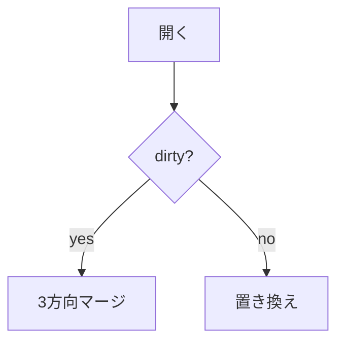

# 週次レポート(2026-11-16)

## 概要

今週は **要件74 第1段** を終え、`CodeEditor.svelte` を入れた。
主な変更は次のとおり:

- コードのファイルと plain text が開いた時点から編集できる
- 外部変更を 3 方向でマージする(重なれば帯)
  - 重なりの数え方は行の単位
- 保存の直前に照合する

1. 周回0 の CodeMirror の分
2. 第1段の周回
3. 人間ゲート

> [!NOTE]
> 第2段は ProseMirror で Markdown の WYSIWYG にする。
> raw は Option + Command + U。

> [!WARNING]
> 次のタグは第2段の完了まで打たない。

| 項目 | 件数 | 備考 |
| :--- | ---: | :---: |
| テスト | 5115 | 全件緑 |
| 変異 | 30 | 生き残り 1[^m] |
| `pnpm check` | 0 | errors |

[^m]: BOM の守り M27。

```ts
export function merge3(base: string, mine: string, theirs: string) {
	return { kind: 'clean', text: mine };
}
```



詳しくは [req-74.md](./docs/requirements/req-74.md) と [設計][arch] を見る。
外部のリンク: <https://prosemirror.net> と https://codemirror.net 。

- [x] 第1段の機械の分
- [ ] 第2段の起案
- [ ] 人間ゲート 11・14・15

---

*注*: この文書は AI が書いた。_斜体_ と __太字__ と ~~取り消し~~ を含む。
エスケープ \* と文字参照 &amp; と &copy; も含む。
改行の印(行末の空白 2 つ)  
とバックスラッシュの改行\
を含む。

[arch]: ./docs/editing-architecture.md "編集の設計"
