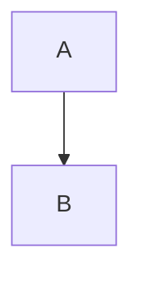

# NodeView の見せ方(2-4)

段落の中の <kbd>Cmd</kbd> と <span class="x" onclick="evil()">span の塊</span> と改行<br>の後。

<div class="note" id="target">
  <p>生 HTML のブロック</p>
  <script>alert(1)</script>
  <a href="javascript:alert(2)">j</a>
  
</div>

画像  と外の画像  を持つ段落。

[ref]: https://e.example/r 'T'

参照リンク [r][ref] と脚注[^m] と二つ目の脚注[^a] と目印へ [go](#target) の段落。

[^m]: M の脚注。

[^a]: A の脚注。



```ts
const x: number = 1;
```

最後の段落。
