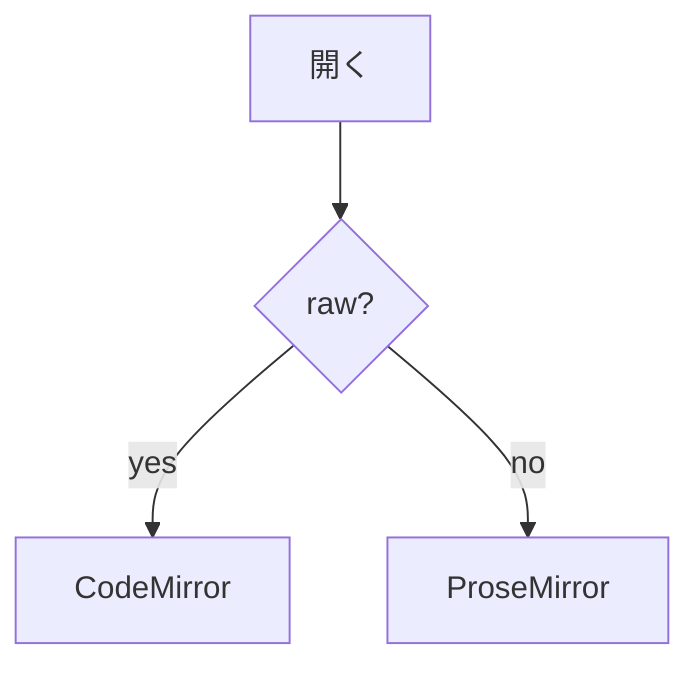

# raw で直すもの(契約7・23・AC-74-6)

描画のまま直しにくいものを集めた文書。編集面では塊(atom)で、View ▸ Raw Source で直す。

<div class="note" data-kind="raw">
  <p>生 HTML のブロック</p>
  <!-- コメントも原文のまま -->
</div>

段落の中の <kbd>Cmd</kbd> と <span class="x">生 HTML のインライン</span> を含む段落。

[ref1]: https://example.com/one
[ref2]: ./relative/two.md 'タイトル'

参照リンク [一つ目][ref1] と [二つ目][ref2] を使う段落。



最後の段落。この下のフェンスは閉じていない。

```js
const unclosed = true;
console.log("fence without a closing line");
